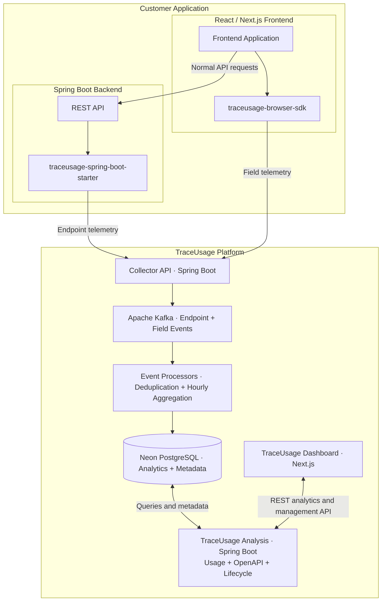

# TraceUsage

**REST API Usage & Deprecation Intelligence Platform**

TraceUsage helps development teams understand how REST APIs are used, identify endpoints and response fields that may warrant cleanup, and make better-informed API lifecycle decisions.

It combines a reusable Spring Boot starter and a TypeScript browser SDK with Kafka-based telemetry ingestion, hourly usage aggregation, Neon PostgreSQL, OpenAPI analysis, and a Next.js dashboard.


## Key Features

- **Endpoint analytics:** Request counts, normalized routes, HTTP status information, and last-seen timestamps.
- **Response-field observations:** Field discovery and JavaScript `Proxy`-based access tracking for instrumented responses.
- **API lifecycle intelligence:** Inactivity, deprecation, and developer review workflows.
- **OpenAPI analysis:** Compare declared API contracts with observed runtime behavior.
- **Asynchronous ingestion:** Kafka topics and background event processors.
- **Efficient storage:** Idempotent processing and hourly usage rollups, with configurable raw-event retention.
- **Environment isolation:** Separate applications and development, staging, and production environments.
- **Privacy-oriented telemetry:** Usage metadata instead of sensitive request or response values.

## System Architecture



The Collector, Kafka consumers, and Analysis API are logical components within the TraceUsage Spring Boot server; they are not required to be separate microservices. The PostgreSQL database runs externally on **Neon**, not in Docker.

## Modules

| Module | Purpose |
|---|---|
| `TraceUsage/` | Spring Boot collector, Kafka processing, authentication, analytics, OpenAPI, and lifecycle logic |
| `traceusage-spring-boot-starter/` | Java SDK for Spring MVC endpoint telemetry |
| `traceusage-browser-sdk/` | TypeScript SDK for response-field discovery and access observations |
| `traceusage-dashboard/` | Next.js dashboard |
| `traceusage-demo-api/` | Sample Spring Boot backend |
| `traceusage-demo-web/` | Sample Next.js frontend |

## Technology Stack

| Layer | Technology |
|---|---|
| Backend and analysis | Java 17, Spring Boot |
| Backend instrumentation | Spring MVC `HandlerInterceptor` |
| Browser instrumentation | TypeScript, JavaScript `Proxy` |
| Event streaming | Apache Kafka |
| Database | Neon PostgreSQL |
| Schema migrations | Flyway |
| Database access | Spring Data JPA and SQL |
| Dashboard | Next.js, React |
| Authentication | JWT, scoped SDK API keys |
| Containerization | Docker Compose |
| API contracts | OpenAPI |

---

# Getting Started — Run the TraceUsage Platform

The core platform runs through Docker Compose. **You do not need a local PostgreSQL container** because the Spring Boot backend connects to an external Neon database.

## 1. Prerequisites

- [Docker Engine](https://docs.docker.com/engine/install/) or [Docker Desktop](https://www.docker.com/products/docker-desktop/)
- [Docker Compose v2](https://docs.docker.com/compose/install/)
- A [Neon](https://neon.tech/) PostgreSQL project
- For the SDKs and demo applications *run directly on your computer*: **JDK 17**, **Maven**, **Node.js**, and **npm**

Verify Docker:

```bash
docker --version
docker compose version
```

## 2. Clone the repository

```bash
git clone https://github.com/DHARAKA-METH/TraceUsage.git
cd TraceUsage
```

## 3. Create a Neon PostgreSQL database

1. Sign in to the [Neon Console](https://console.neon.tech/).
2. Create a project and database, or select an existing database.
3. Copy its host, database name, username, and password.
4. Convert the connection URL to the PostgreSQL **JDBC** format used by Spring Boot:

```text
jdbc:postgresql://YOUR_NEON_HOST/YOUR_DATABASE?sslmode=require
```

Use a pooled Neon endpoint for application queries if appropriate; consider a direct connection for Flyway/schema migration operations. **Flyway migrations modify the configured Neon database**, so select the intended development database/branch.

## 4. Create your `.env` file

From the repository root:

```bash
cp .env.example .env
```

Edit `.env` and replace the placeholders:

```dotenv
# External Neon PostgreSQL (not a local Docker database)
SPRING_DATASOURCE_URL=jdbc:postgresql://YOUR_NEON_HOST/YOUR_DATABASE?sslmode=require
SPRING_DATASOURCE_USERNAME=YOUR_NEON_USERNAME
SPRING_DATASOURCE_PASSWORD=YOUR_NEON_PASSWORD

# Dashboard authentication
JWT_SECRET=REPLACE_WITH_A_LONG_RANDOM_SECRET

# Browser-facing address of the TraceUsage backend
NEXT_PUBLIC_TRACEUSAGE_API_URL=http://localhost:8080
```

To generate a random secret:

```bash
openssl rand -base64 48
```


## 5. Start the platform

Validate the Compose configuration:

```bash
docker compose config --quiet
```

Build and start the services:

```bash
docker compose up -d --build
```

| Service | Where it runs | Address |
|---|---|---|
| TraceUsage Dashboard | Docker | http://localhost:3000 |
| TraceUsage Collector and Analysis API | Docker | http://localhost:8080 |
| Apache Kafka (host listener) | Docker | `localhost:9094` |
| Apache Kafka (internal Docker listener) | Docker network | `kafka:9092` |
| PostgreSQL | Neon cloud | External JDBC connection |

Check startup status:

```bash
docker compose ps
docker compose logs --tail=100 backend
```

If Actuator health checks are enabled:

```bash
curl http://localhost:8080/actuator/health
```

Expected healthy response:

```json
{"status":"UP"}
```

List Kafka topics:

```bash
docker exec traceusage-kafka \
  /opt/kafka/bin/kafka-topics.sh \
  --bootstrap-server localhost:9092 \
  --list
```

The backend is expected to configure these topics where automatic topic creation is enabled:

```text
traceusage.endpoint-events
traceusage.field-events
traceusage.endpoint-events.dlt
traceusage.field-events.dlt
```

## 6. Create a monitored application

1. Open **http://localhost:3000**.
2. Register or log in.
3. Create a TraceUsage application (for example, `Demo Store`).
4. Select an environment (for example, `Development`).
5. Generate the SDK credentials for that application/environment:
   - **Backend secret key:** `tru_sk_...` — use only in server-side applications.
   - **Browser public key:** `tru_pk_...` — use only for restricted telemetry ingestion.
6. Copy the values into your application's local environment configuration, **not into source control**.

---

# Integrate TraceUsage into Your Own Application

The following instructions are for a **new Spring Boot backend** and a **new React/Next.js frontend**, not just the included demos.

## 7. Spring Boot backend integration

### 7.1 Build and install the backend SDK locally

The starter is currently provided as a local Maven artifact. From the **TraceUsage repository root**:

```bash
cd traceusage-spring-boot-starter
mvn clean install
cd ..
```

This adds the starter to your machine's local Maven repository (`~/.m2/repository`). It is **not necessary to install it into the running TraceUsage server container**; this installation is for your customer Spring Boot application running on your host.

> The current starter is built against **Spring Boot 4.1.1** and **Java 17**. Check compatibility with your application's Spring Boot release before integrating it.

### 7.2 Add the dependency to your application's `pom.xml`

In your **new Spring Boot application's** `<dependencies>` section, add:

```xml
<dependency>
    <groupId>com.traceusage</groupId>
    <artifactId>traceusage-spring-boot-starter</artifactId>
    <version>1.0.0-SNAPSHOT</version>
</dependency>
```

These coordinates match the starter's `pom.xml` in this repository. If you release a different version in the future, update this example accordingly.

### 7.3 Configure `application.properties`

Open your application's:

```text
src/main/resources/application.properties
```

Add:

```properties
# Your application's HTTP port (change if needed)
server.port=8081

# TraceUsage backend instrumentation
traceusage.enabled=true
traceusage.server-url=${TRACEUSAGE_SERVER_URL:http://localhost:8080}
traceusage.api-key=${TRACEUSAGE_API_KEY}

# Optional SDK settings
traceusage.batch-size=100
traceusage.queue-capacity=10000
traceusage.max-retries=3
traceusage.retry-delay-millis=1000
```

The `traceusage.server-url` and `traceusage.api-key` properties match the included demo backend's current configuration.

### 7.4 Set the secret API key outside source code

On Linux/macOS, in the terminal that starts your application:

```bash
export TRACEUSAGE_SERVER_URL=http://localhost:8080
export TRACEUSAGE_API_KEY='YOUR_BACKEND_SECRET_KEY'
```

Replace `YOUR_BACKEND_SECRET_KEY` with the `tru_sk_...` key generated in the dashboard. 


### 7.5 Run and verify your Spring Boot application

From the **new backend application's directory**:

```bash
mvn spring-boot:run
```


## 8. React / Next.js frontend integration

The browser SDK is a **local npm package** named `@traceusage/browser`. The current package is marked `private`, so install it from this repository rather than assuming it is available on the public npm registry.

### 8.1 Build the browser SDK

From the **TraceUsage repository root**:

```bash
cd traceusage-browser-sdk
npm install
npm run build
cd ..
```

### 8.2 Install it in your own frontend project

From **your React/Next.js application's directory**, run:

```bash
npm install /ABSOLUTE/PATH/TO/TraceUsage/traceusage-browser-sdk
```

Replace the path with the actual location of your cloned TraceUsage repository.

Import using the real package name:

```typescript
import { TraceUsageClient } from "@traceusage/browser";
```

### 8.3 Configure frontend `.env.local`

For a **Next.js** frontend, create `.env.local` in the frontend project root:

```dotenv
# Your application's Spring Boot backend
NEXT_PUBLIC_DEMO_API_URL=http://localhost:8081

# TraceUsage Collector (browser-facing URL)
NEXT_PUBLIC_TRACEUSAGE_SERVER_URL=http://localhost:8080

# Restricted browser telemetry key generated in the dashboard
NEXT_PUBLIC_TRACEUSAGE_PUBLIC_KEY=YOUR_BROWSER_PUBLIC_KEY

# Optional attribution metadata
NEXT_PUBLIC_TRACEUSAGE_PROJECT_ID=YOUR_TRACEUSAGE_PROJECT_ID
NEXT_PUBLIC_TRACEUSAGE_CLIENT_ID=my-nextjs-app
NEXT_PUBLIC_TRACEUSAGE_CLIENT_VERSION=1.0.0
```


### 8.4 Start your frontend

Start using your frontend's normal command (for example, `npm run dev`). Ensure it doesn't conflict with the TraceUsage dashboard on `3000`; the included demo runs on `3001`.

Open the browser's **Developer Tools → Network** panel to inspect outgoing field telemetry requests to the TraceUsage Collector.

---

# Run the Included Demo Applications

Use these demos to verify the platform before instrumenting another application.

## 9. Demo Spring Boot API

The demo API's `pom.xml` already includes the TraceUsage Maven starter dependency, and its default server port is `8081`.

First build the starter:

```bash
cd traceusage-spring-boot-starter
mvn clean install
cd ..
```

**Configure the demo API to use environment variables before starting it.** In `traceusage-demo-api/src/main/resources/application.properties`, the sensitive key should be read from the environment:

```properties
server.port=8081
traceusage.enabled=true
traceusage.server-url=${TRACEUSAGE_SERVER_URL:http://localhost:8080}
traceusage.api-key=${TRACEUSAGE_API_KEY}
```

You may keep the existing nonsecret SDK batching settings in that file. **Remove any hardcoded `tru_sk_...` value currently in the tracked configuration file.**

Set the key in your terminal:

```bash
export TRACEUSAGE_SERVER_URL=http://localhost:8080
export TRACEUSAGE_API_KEY='YOUR_BACKEND_SECRET_KEY'
```

Start the demo API:

```bash
cd traceusage-demo-api
mvn spring-boot:run
```

The API listens on **http://localhost:8081**.

## 10. Demo Next.js frontend

Open another terminal from the **TraceUsage repository root**:

```bash
cd traceusage-browser-sdk
npm install
npm run build
cd ../traceusage-demo-web
npm install
```

The demo frontend's `package.json` **already references** `@traceusage/browser` using `file:../traceusage-browser-sdk`, so no additional `npm install /path/to/...` command is needed for this included demo.

Create the demo frontend's `.env.local`:

```bash
cp .env.example .env.local
```

Replace the placeholders in `.env.local`:

```dotenv
NEXT_PUBLIC_DEMO_API_URL=http://localhost:8081
NEXT_PUBLIC_TRACEUSAGE_SERVER_URL=http://localhost:8080
NEXT_PUBLIC_TRACEUSAGE_PUBLIC_KEY=YOUR_BROWSER_PUBLIC_KEY
NEXT_PUBLIC_TRACEUSAGE_PROJECT_ID=YOUR_TRACEUSAGE_PROJECT_ID
NEXT_PUBLIC_TRACEUSAGE_CLIENT_ID=product-web
NEXT_PUBLIC_TRACEUSAGE_CLIENT_VERSION=1.0.0
```

The demo frontend already initializes `TraceUsageClient` and calls `trackResponse()` on product JSON responses.

Start it:

```bash
npm run dev
```

The demo's existing script runs Next.js on **http://localhost:3001**.

## 11. Generate and inspect telemetry

1. Open the demo frontend at **http://localhost:3001** and load the product page.
2. The demo calls its Spring Boot API at **http://localhost:8081**.
3. The backend starter collects endpoint metadata; the browser SDK observes fields read from the instrumented product response.
4. The SDKs submit telemetry to the Collector at **http://localhost:8080**.
5. Kafka processors persist usage aggregates in **Neon PostgreSQL**.
6. Open the dashboard at **http://localhost:3000** and select the correct application/environment.
7. Inspect endpoint usage, field observations, lifecycle analysis, and OpenAPI intelligence.

You can also send direct endpoint requests, using an endpoint implemented by the demo API:

```bash
curl http://localhost:8081/api/products/101
```

New telemetry may not appear immediately because SDKs buffer data and Kafka processes it asynchronously. A direct `curl` call tests endpoint telemetry, **not** browser field access; interact with the frontend to generate field observations.

---

## Telemetry Processing

```text
Customer Backend SDK ── Endpoint Events ──┐
                                         ├──> TraceUsage Collector
Customer Browser SDK ── Field Events ────┘              |
                                                       v
                                                  Apache Kafka
                                                       |
                                                       v
                                      Deduplication + Hourly Rollups
                                                       |
                                                       v
                                                Neon PostgreSQL
                                                       |
                                                       v
                                            Spring Boot Analysis
                                                       |
                                                       v
                                             Next.js Dashboard
```

## Stop and Restart

Stop demo applications started with Maven or npm using `Ctrl+C` in their terminal windows.

Stop the Docker platform without deleting its Kafka named volume:

```bash
docker compose down
```

Start it again:

```bash
docker compose up -d
```

Rebuild platform images after code changes:

```bash
docker compose up -d --build
```

**Warning:** `docker compose down -v` removes Docker-managed named volumes (including Kafka data). It does **not** delete the external Neon database.

## Troubleshooting

| Issue | What to check |
|---|---|
| Containers fail to start | `docker compose ps` and `docker compose logs --tail=100 backend` |
| Backend cannot connect to Neon | Database hostname, SSL mode, username, password, connectivity, and Flyway logs |
| Backend cannot connect to Kafka | From Docker the broker address is `kafka:9092`, not `localhost:9092` |
| Authentication/JWT configuration fails | Align the backend's JWT property with the Compose environment variable |
| Maven cannot resolve the starter | Run `mvn clean install` in `traceusage-spring-boot-starter`, then use version `1.0.0-SNAPSHOT` |
| New frontend cannot import SDK | Build `traceusage-browser-sdk`, install its local path, check `@traceusage/browser` |
| No browser field telemetry | Verify public key, `NEXT_PUBLIC_TRACEUSAGE_SERVER_URL`, instrumented `trackResponse()` calls, and CORS |
| No backend endpoint telemetry | Verify secret `TRACEUSAGE_API_KEY`, Collector URL, and incoming requests |
| Dashboard displays no usage | Select correct application/environment and inspect Kafka consumer logs |
| Demo frontend shows port conflict | Dashboard uses `3000`; demo web uses `3001`; demo API uses `8081` |

## Privacy and Limitations

- Do not submit passwords, JWTs, Authorization headers, sensitive request bodies, or personal response values as telemetry.
- The browser SDK observes property reads only on supported instrumented JavaScript response objects. It does not observe uninstrumented mobile or third-party consumers.
- Object spreading, serialization, and rerenders may affect access-count interpretation.
- `0` observed field accesses means **no access was observed from covered clients during the observation window**, not that the field is universally unused.
- TraceUsage does not automatically remove endpoints or fields. Review contract compatibility, client coverage, and business requirements before making changes.
- The included single-node Kafka Compose setup is intended for local development and demonstration, not a highly available production Kafka cluster.

## Security Notes

- Keep `.env` and `.env.local` out of Git.
- Never expose backend `tru_sk_...` keys in browser bundles.
- Public `tru_pk_...` keys must be restricted to telemetry ingestion.
- If a real API key or database password was ever committed, **revoke/rotate it**. Removing it from the latest source file does not erase the credential from Git history.
- Run database migrations against an intended Neon development database or branch before applying them to production data.

## Repository

Source: **https://github.com/DHARAKA-METH/TraceUsage**
