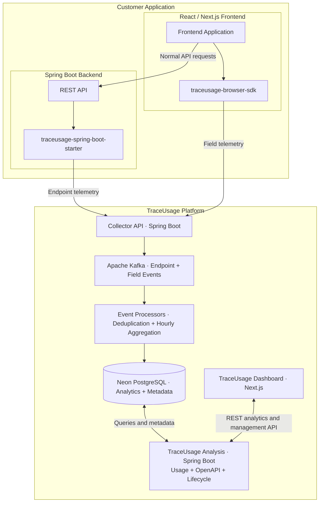

# TraceUsage

REST API usage and deprecation intelligence platform.

TraceUsage helps development teams understand how REST APIs in production are actually used, identify endpoints and response fields that may need cleanup, and make better-informed lifecycle decisions.

It includes a reusable Spring Boot starter and a TypeScript browser SDK for telemetry, plus Kafka-based ingestion, hourly usage aggregation, a Neon PostgreSQL backend, OpenAPI analysis, and a Next.js dashboard.

## Key features

- Endpoint analytics: request counts, normalized routes, HTTP status distribution, and last-seen timestamps.
- Response-field observations: automatic field discovery and JavaScript Proxy–based access tracking for instrumented responses.
- API lifecycle intelligence: inactivity detection, deprecation workflows, and developer review support.
- OpenAPI analysis: compare declared contracts with observed runtime behavior.
- Asynchronous ingestion: Kafka topics and background processors for resilient telemetry handling.
- Efficient storage: idempotent processing and hourly usage rollups, with configurable raw-event retention.
- Environment isolation: separate configuration for development, staging, and production.
- Privacy-oriented: collects usage metadata rather than sensitive request or response values.

## System architecture



> The Collector, Kafka consumers, and Analysis API are logical components within the TraceUsage Spring Boot server; they do not have to be separate microservices. The analytics database is expected to run in Neon (cloud), not as a local container.

## Repository modules

- TraceUsage/ — Spring Boot collector, Kafka processing, authentication, analytics, OpenAPI, and lifecycle logic
- traceusage-spring-boot-starter/ — Java SDK for Spring MVC endpoint telemetry
- traceusage-browser-sdk/ — TypeScript SDK for response-field discovery and access observations
- traceusage-dashboard/ — Next.js dashboard
- traceusage-demo-api/ — Sample Spring Boot backend
- traceusage-demo-web/ — Sample Next.js frontend

## Technology stack

- Backend and analysis: Java 17, Spring Boot
- Backend instrumentation: Spring MVC HandlerInterceptor
- Browser instrumentation: TypeScript, JavaScript Proxy
- Event streaming: Apache Kafka
- Database: Neon PostgreSQL
- Schema migrations: Flyway
- Database access: Spring Data JPA and SQL
- Dashboard: Next.js, React
- Authentication: JWT, scoped SDK API keys
- Containerization: Docker Compose
- API contracts: OpenAPI

---

# Quick start — run TraceUsage locally

This guide uses Docker Compose and an external Neon PostgreSQL database. You do not need a local Postgres container.

Prerequisites

- Docker Engine or Docker Desktop
- Docker Compose v2
- A Neon PostgreSQL project
- For building SDKs and demos locally: JDK 17, Maven, Node.js, npm

1) Clone the repository

```bash
git clone https://github.com/DHARAKA-METH/TraceUsage.git
cd TraceUsage
```

2) Create a Neon PostgreSQL project

- Create or select a Neon project and database in the Neon Console.
- Copy the host, database name, username, and password.
- Convert the connection URL to JDBC for Spring Boot:

```text
jdbc:postgresql://YOUR_NEON_HOST/YOUR_DATABASE?sslmode=require
```

Note: Run Flyway migrations against the intended development Neon database or branch before applying to production data.

3) Create your .env file

```bash
cp .env.example .env
```

Edit `.env` and set:

```dotenv
SPRING_DATASOURCE_URL=jdbc:postgresql://YOUR_NEON_HOST/YOUR_DATABASE?sslmode=require
SPRING_DATASOURCE_USERNAME=YOUR_NEON_USERNAME
SPRING_DATASOURCE_PASSWORD=YOUR_NEON_PASSWORD

JWT_SECRET=REPLACE_WITH_A_LONG_RANDOM_SECRET

NEXT_PUBLIC_TRACEUSAGE_API_URL=http://localhost:8080
```

Generate a strong JWT secret:

```bash
openssl rand -base64 48
```

4) Start the platform

Validate compose config:

```bash
docker compose config --quiet
```

Build and start:

```bash
docker compose up -d --build
```

Services and default addresses

- TraceUsage Dashboard — http://localhost:3000
- TraceUsage Collector and Analysis API — http://localhost:8080
- Kafka (host listener) — localhost:9094
- Kafka (internal) — kafka:9092 (Docker network)
- PostgreSQL — Neon cloud (external JDBC)

Check startup status and logs:

```bash
docker compose ps
docker compose logs --tail=100 backend
curl http://localhost:8080/actuator/health
```

Expected health response: `{"status":"UP"}`

List Kafka topics (inside the Kafka container):

```bash
docker exec traceusage-kafka \
  /opt/kafka/bin/kafka-topics.sh \
  --bootstrap-server localhost:9092 \
  --list
```

Expected topics (when auto-creation is enabled):

```
traceusage.endpoint-events
traceusage.field-events
traceusage.endpoint-events.dlt
traceusage.field-events.dlt
```

5) Create a monitored application

- Open the dashboard at http://localhost:3000
- Register or log in, then create an application (for example, “Demo Store”) and an environment (for example, Development)
- Generate SDK credentials for the application/environment:
  - Backend secret key (use only server-side): `tru_sk_...`
  - Browser public key (restricted ingestion): `tru_pk_...`
- Store these values in environment variables — do not commit them to source control.

---

# Integrate TraceUsage into your applications

These steps describe integrating a new Spring Boot backend and a new React/Next.js frontend.

Spring Boot backend

1. Build and install the backend SDK locally (from the repository root):

```bash
cd traceusage-spring-boot-starter
mvn clean install
cd ..
```

2. Add the dependency to your application's `pom.xml`:

```xml
<dependency>
  <groupId>com.traceusage</groupId>
  <artifactId>traceusage-spring-boot-starter</artifactId>
  <version>1.0.0-SNAPSHOT</version>
</dependency>
```

3. Configure `application.properties` (example):

```properties
server.port=8081

traceusage.enabled=true
traceusage.server-url=${TRACEUSAGE_SERVER_URL:http://localhost:8080}
traceusage.api-key=${TRACEUSAGE_API_KEY}

# Optional SDK settings
traceusage.batch-size=100
traceusage.queue-capacity=10000
traceusage.max-retries=3
traceusage.retry-delay-millis=1000
```

4. Export the secret key outside source code (example):

```bash
export TRACEUSAGE_SERVER_URL=http://localhost:8080
export TRACEUSAGE_API_KEY='YOUR_BACKEND_SECRET_KEY'
```

5. Run your Spring Boot application:

```bash
mvn spring-boot:run
```

Frontend (React / Next.js)

1. Build the browser SDK (from repository root):

```bash
cd traceusage-browser-sdk
npm install
npm run build
cd ..
```

2. Install the SDK into your frontend project (use an absolute local path):

```bash
npm install /ABSOLUTE/PATH/TO/TraceUsage/traceusage-browser-sdk
```

3. Import and initialize:

```ts
import { TraceUsageClient } from "@traceusage/browser";

const traceUsage = new TraceUsageClient({
  projectId: "proj_xxxxx",
  clientId: "product-web",
  clientVersion: "1.0.0",
  transport: {
    serverUrl: "http://localhost:8080",
    publicKey: "tru_pk_xxxxx",
  },
});

const product = traceUsage.trackResponse(responseData, {
  method: "GET",
  endpoint: "/api/products/{id}",
  schema: "Product",
});

product.name; // observed access
```

4. For Next.js, create `.env.local` with the required NEXT_PUBLIC_* values (see examples in the repository).

---

# Included demos

- Demo Spring Boot API: `traceusage-demo-api/` (default port 8081). Build the starter and set environment variables before starting.
- Demo Next.js frontend: `traceusage-demo-web/` (default port 3001). The demo references the local `@traceusage/browser` SDK.

Demo commands (examples):

```bash
# Build starter
cd traceusage-spring-boot-starter
mvn clean install
cd ..

# Start demo API
cd traceusage-demo-api
mvn spring-boot:run

# Build SDK and start demo web
cd traceusage-browser-sdk
npm install
npm run build
cd ../traceusage-demo-web
npm install
npm run dev
```

# Telemetry processing (overview)

Customer SDKs → TraceUsage Collector → Kafka → Deduplication & Hourly Rollups → Neon PostgreSQL → Spring Boot Analysis → Next.js Dashboard

# Stop and restart

Stop demos started with Maven/npm with Ctrl+C. To stop Docker platform without deleting Kafka data:

```bash
docker compose down
```

Restart:

```bash
docker compose up -d
```

Rebuild after code changes:

```bash
docker compose up -d --build
```

Warning: `docker compose down -v` removes Docker named volumes (including Kafka data); it does not delete the external Neon database.

# Troubleshooting

- Containers fail to start: check `docker compose ps` and `docker compose logs --tail=100 backend`.
- Backend cannot connect to Neon: verify host, SSL mode, username, password, and Flyway logs.
- Backend cannot connect to Kafka: from Docker the broker address is `kafka:9092` (not `localhost:9092`).
- Authentication/JWT issues: align backend properties with Compose environment variables.
- Maven cannot resolve the starter: run `mvn clean install` in `traceusage-spring-boot-starter` and use version `1.0.0-SNAPSHOT`.
- Frontend cannot import SDK: build `traceusage-browser-sdk` and install via local path.
- No browser field telemetry: check public key, `NEXT_PUBLIC_TRACEUSAGE_SERVER_URL`, instrumented `trackResponse()` calls, and CORS.
- No backend endpoint telemetry: check `TRACEUSAGE_API_KEY`, Collector URL, and incoming requests.
- Dashboard shows no usage: ensure correct application/environment is selected and inspect Kafka consumer logs.

# Privacy & security

- Keep `.env` and `.env.local` out of Git.
- Never expose backend `tru_sk_...` keys in browser bundles.
- Restrict public `tru_pk_...` keys to telemetry ingestion.
- If a real API key or database password was ever committed, revoke/rotate it — removing it from the latest commit does not erase it from Git history.
- Run migrations against an intended Neon development database or branch before applying to production.

---

Source: https://github.com/DHARAKA-METH/TraceUsage
